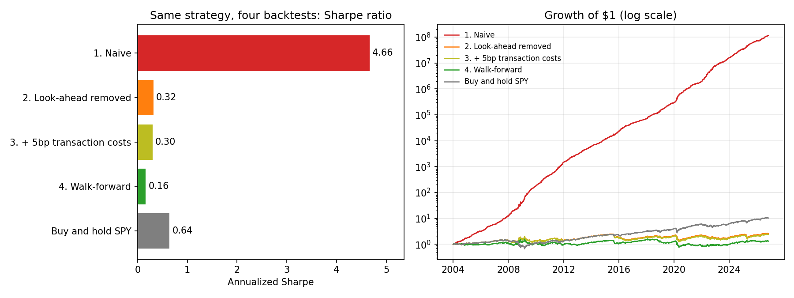

# Backtests that lie

One simple momentum strategy on SPY, backtested four times. Each version fixes one common mistake, and the Sharpe ratio falls from **4.66 to 0.16**.



My research is about results that look real but aren't: LLMs exploiting patterns in their tests, sequencing artifacts.
This project applies the same skepticism to trading backtests.

## The strategy

Time-series momentum: go **long SPY** if its trailing *L*-day return is positive, **short** if negative.
*L* is picked from {5, 10, 20, 60, 120, 250} trading days. Daily data, 2004-01-02 to 2026-10-30, every row scored on the same days.

## Four backtests of the same idea

| Backtest | What changes | Sharpe | Ann. return |
|---|---|---:|---:|
| 1. Naive | Signal uses today's close to trade today's return; best *L* picked on the same data it's scored on; no costs | **4.66** | 83.2% |
| 2. Look-ahead removed | Trade today on *yesterday's* signal | 0.32 | 5.9% |
| 3. + 5bp transaction costs | Pay 5bp per unit of turnover (a long→short flip is 2 units) | 0.30 | 5.5% |
| 4. Walk-forward | Each year, pick *L* using only the previous 3 years, then trade that year out of sample | **0.16** | 3.0% |
| Buy and hold SPY | | 0.64 | 12.0% |

**What each step shows**

1. **Look-ahead is the big lie.** At *L* = 5, today's return is a fifth of the signal, so the naive backtest partly "predicts" a move it has already seen. One `.shift(1)` takes the Sharpe from 4.66 to 0.32. It turns $1 into about $100 million on paper.
2. **Costs barely matter here, and that's a trap too.** The honest in-sample winner is *L* = 250, which trades rarely, so 5bp costs almost nothing. Fast signals aren't so lucky: at *L* = 5 the strategy turns over about 100 units a year, and costs push its Sharpe from −0.27 to −0.55.
3. **Choosing the best parameter on the data you report is selection bias.** Walk-forward picks a different *L* almost every year (`10` through `250`), because there's no stable best lookback, just noise that looked best last time. Out of sample, the Sharpe halves again.
4. **The honest answer:** this strategy loses to doing nothing (buy and hold, 0.64).

## The proof that step 1 is fake

`test_backtest.py` runs the strategy on a **random walk with no momentum by construction**:

- The naive look-ahead backtest still reports Sharpe **> 2** on pure noise.
- The honest version reports about 0.
- Transaction costs never improve any day's return.
- Walk-forward is checked for leakage: changing only the final year's prices must not change any earlier year's pick.

## Run it

```bash
pip install -r requirements.txt
python backtest.py      # prints the table, writes sharpe_decay.png
python -m pytest -q
```

`spy.csv` is the cached price data (adjusted closes from Yahoo Finance), so the numbers reproduce exactly. Delete it to re-download.

## What I left out, on purpose

The Sharpe ratios ignore the risk-free rate, which would lower every row about equally. There are no shorting costs, and the strategy runs on one asset.
Adding those would make the honest rows look worse, not better, so the conclusion holds.
